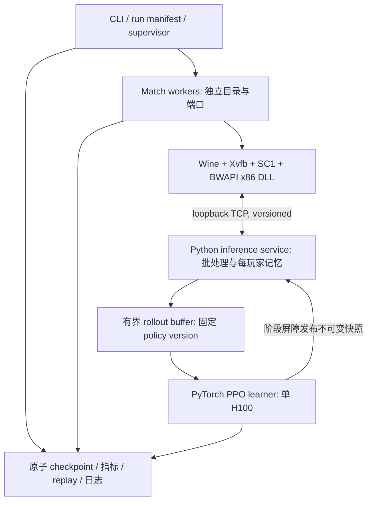

# StarForge H100 单机架构设计

日期：2026-10-23。状态：为 Linux 接续开发编写的设计，尚未部署/训练。

## 1. 目标、范围与依据

用户目标是完整 SC1 1v1 RL agent，长期对标 Pluto；已有 x86-64 Linux、40 个可见 CPU、
314 GiB RAM、单张 H100 NVL（95,830 MiB）。本设计覆盖迁移、真实游戏闭环、
单机同步 PPO、实体/空间/记忆模型与受控自博弈。所有下述默认值是实施者建议，
不是用户指定超参数或 Pluto 训练配方。

先做人族混合基线，再扩大控制范围。三族端到端策略、分布式多节点、历史对手联赛、
OpenBW 训练替换、315M 级网络均留待测量后另立计划。GPU 容量不能证明达到 Pluto 强度所需算力足够。

新计划替代 2026-10-22 设计中“规模化必含历史池”的路线要求；历史池是后续可选实验。
已有 v1 协议、表格基线及其来源隔离语义保留。

## 2. 方案选择与兼容性闸门

首选：Linux 原生 Python + PyTorch，Wine/Xvfb 运行原版游戏及 Windows BWAPI 模块。
Xvfb 提供虚拟显示，不等于无渲染引擎、确定性加速器或无限帧速。训练快进与比赛运行
必须各自记录时序。游戏需合法可用的 1.16.1 资源；版本匹配 BWAPI 4.4.0。

关键前置：当前 DLL 项目要求 MSVC，BWAPI SDK 的 C++ ABI/runtime 不能通过简单
删除 CMake 平台检查或换 MinGW 来保证兼容。优先用可复现 Windows MSVC x86 构建
提供 DLL（既有 Windows 机器或用户可用的构建服务）；若全 Linux 构建，先调查并验证
兼容的 MSVC 工具链方案和依赖使用条件。保留 PE 类型、导出符号、依赖和实际加载证据。
不能只检查 `.dll` 后缀或编译成功。构建通路未解决时继续做 Python 独立任务。

回退：Windows x64 game worker + Linux learner。推理与游戏同机，通过批量轨迹/权重
同步连接 learner，避免逐帧跨公网 RPC。该回退需要新的部署配置，不能假装现有串行
serve 已提供分布式能力。OpenBW/TorchCraft 仅作为另行比较的训练后端，不假设可直接加载 Pluto DLL。

## 3. 进程架构



职责划分：

| 组件 | 职责和边界 |
|---|---|
| Bridge | 只从合法玩家视角读取观测，校验/执行动作，回报执行帧和错误；不做梯度更新 |
| Match worker | 创建/结束对局，持有所属进程、双方 endpoint、回放和实例目录；不改策略权重 |
| Supervisor | 调度/超时/重启/收集结果；错误重试有次数上限，不将故障计为败局 |
| Inference | 对独立玩家请求批处理；按 episode/player 管理 hidden state；只读取固定策略快照 |
| Collector | 保存 obs/action/mask/logprob/value/reward/边界/版本；有界队列，禁止静默丢步 |
| Learner | 计算 GAE/PPO，更新模型、优化器和训练状态；不启动游戏 |
| Evaluator | 固定模型、对手、地图和规则；独立实例/统计文件，不反向影响训练 |

单机先用 Python multiprocessing（spawn）、loopback TCP 和本地文件；不引入 Ray、
Kubernetes、Redis、分布式参数服务器。JSON 协议先求可审计；只有序列化占用经 profile
证明是瓶颈才改二进制或共享内存，不能跨位数传 Python/C++ 原生对象或指针。

## 4. 对局、隔离与生命周期

一个 match 有两个 player slot；自博弈需两个游戏客户端分别加载各自 DLL。
StarForge vs builtin 的单客户端测试不证明两端自博弈已打通。
“worker 数”指并行 match 数；自博弈最多有两倍游戏客户端，CPU 预算据此计算。

每客户端独立可写游戏目录、BWAPI write/read、日志、端口；优先每客户端独立 Wine prefix，
同一 match 通过实际验证的 LAN/比赛管理器配对。不要假设同名 mutex 或共享 prefix 可安全并发。
runner 启动器接口接受明确 argv、cwd、env、pid/process group，不拼接 shell 字符串。
使用的比赛管理器版本、配置、入房、开局、退出和重开命令必须经真实验证并记入文档，
本文不虚构 BWAPI 的“自动启动 CLI”。先探测已有开源管理器，再决定必要的最小适配器。

状态机：PREPARING → STARTING → CONNECTED → RUNNING → FINALIZING → FINISHED；
任一步可转 ERROR/CANCELLED。每次重试使用新 episode_id，并保留失败 attempt。
连接、帧推进、终局、进程退出分别有 deadline；策略更新屏障允许暂停帧推进，但仍监测
进程存活/控制心跳，不能把一次正常 PPO update 判作游戏卡死。
只终止 supervisor 自己启动并记录的进程组；不使用全局 `pkill wine`。

终局：胜/负/明确平局是游戏结果；外部帧限制为 truncated；崩溃、EOF、通信错误为 error。
两客户端终局相互核对，不一致则标记 disputed/error，不能把两端记录当两场独立比赛。
Pluto 每个评测实例有隔离的 bandit 统计；默认每场从相同干净状态开始（cold-start profile），
持续适应实验使用另一 profile，不能混合统计。

## 5. 观测、动作和时序契约

v1 原样支持，继续用于 24 帧/6 宏动作混合基线。v2 放在独立模块，不向严格 v1
对象偷偷加字段。v2 连接首包 hello 协商 schema、policy family、player/episode、
timing profile；不兼容必须立即报错。

v2 envelope 必须有：protocol=2、run_id、worker_id、episode_id、player_id、seq、
frame、observation_schema、action_schema、policy_version、timing_profile。
transition 必须有：obs、采样时完整合法 mask、action（分支与参数）、old_logprob、
old_value、reward_components、terminated、truncated、valid、bootstrap_value、
applied_frame、command_status、policy_version；循环模型再加 hidden/reset 信息。
握手时钉住协议/动作/特征顺序、单位/坐标规范；用版本清单而非靠 Python 字典顺序推断。

执行器重查合法性。失效命令仍记录原始采样动作、拒绝原因和实际 no-op 效果，
不得改写采样动作或其 logprob；奖励来自环境变化，不额外惩罚以掩盖协议错误。
重复 seq、跨 episode 响应、过期版本或超过动作 deadline 的响应不再执行。

第一套 PPO 仍使用 v1 的 6 个宏动作，但通过 v2 学习契约采集，policy_family=`macro_ppo`。
后续 `entity_ppo` 单独 schema：己方单位、当前可见敌方/中立单位、资源/科技和地图空间特征；
稳定实体 ID、padding mask、未知/不可见标志。不把全知 enemy coordinates、地图真实
起点或隐藏经济传进 actor/critic。critic 初版和 actor 使用同等信息，奖励也不依赖
未声明的全知输入。不会把隐藏敌人消失简单记成击杀。

实体动作逐步增加可控单位选择、命令、目标单位/位置/生产参数；有条件动作头的
joint logprob 只累加实际激活分支，各分支用对应条件 mask。明确保留的规则控制，
在 manifest 标记 `hybrid=true`，不能声称已实现端到端微操。单位上限、空间分辨率和
具体特征表在实体任务先写 schema 再编码；超过上限不能静默截掉实体（见计划 Task 7）。

时序默认：macro baseline 每 24 帧；entity 实验起步每 6 帧。记录 observation_frame、
applied_frame、game latency、wall inference/queue latency。阻塞模式必须先验证双方
暂停/步进语义；若游戏不能精确停帧则显式采用观测到的延迟 profile，训练与评测一致。
不是设置 `decision_frames=6` 就复现了 Pluto 的反应时间或比赛规则。

## 6. PPO 与数据一致性

选择标准 clipped PPO + GAE（StarForge 自己的实现选择）。先 MLP 宏动作，再实体编码和 GRU。
采用严格同步迭代：冻结 θ_k → 采样固定版本 rollout → 暂停采样 → learner 更新 →
原子发布 θ_k+1 → 推理确认版本后继续。初版不接受跨版本数据、异步滞后修正或历史对手池。
自博弈双方在同一迭代使用 θ_k；训练前固定对手的阶段也单独记录 opponent manifest。

同一 match 的双方请求必须独立入队、同时可处理；不能等玩家 A 的下一步才回复 B
的当前步。屏障以配对 match 为单位停下，不让一侧跨入新版本。按配对决策轮计数，
每轮先服务双方当前动作，再收集 successor；不是每个玩家各自凑满有效样本才停。
每 match 最多 256 轮，任一方终局/故障则共同结束该窗口；在安全边界收尾在途回复，
未完成 transition 标 invalid，短窗口 padding 到 256。初版同一个窗口不重开新局补数，
早结束 match 等全局更新后再开局。双方有效步数可不同，归一化只计 valid 样本；
零有效样本的 batch 跳过更新并记录。先用延迟不对称的双客户端夹具和真实对局验证。

建议初始参数（全部配置化并保存到 manifest，调整必须写实验理由）：

| 项 | 起步值 |
|---|---|
| rollout | 每 match 最多 256 个配对决策轮；双方变长有效片段 + padding/valid mask；不跨局补数 |
| PPO | clip=0.2，epochs=4，Adam lr=3e-4，grad norm=0.5 |
| GAE | gamma=0.999 / decision，lambda=0.95；比较 6/24 帧实验时需换算同等时间尺度 |
| 损失 | policy + 0.5×value MSE - 0.01×masked entropy；初版不用 value clipping |
| 精度 | 先 FP32 数学验收；H100 用 BF16 autocast 做前向，logprob/GAE/loss 保持 FP32 |
| 训练 batch | rollout 有效样本整体标准化 advantage；小样本方差保护；MLP minibatch 最多 1024 |
| 监控 | approx KL、clip fraction、entropy、value error、explained variance、grad norm、非法动作率 |

终局 bootstrap=0；rollout 截断或正常时间限制且有可信最后观测时 bootstrap=V(last_obs)。
时间限制处停止 GAE 跨 episode 传播，但保留该步 bootstrap。
error 没有可信 successor 时丢弃不完整 transition；之前有效片段在最后可信 obs
bootstrap 并切断 trace，绝不造一个输局奖励。存 bootstrap mask 与 trace-continuation
mask 两套边界，不用一个 `done` 同时表达全部情况。

循环模型初版：每个同步 rollout 边界（最多 256 轮）对双方显式 reset hidden，作为策略语义记录，
消除更新时把旧权重 hidden 无标识地接给新权重；episode reset 也归零。这限制跨窗口
记忆，是起步折衷。非终局窗口尾部的 bootstrap 使用旧权重 θ_k、零 hidden 对最后可信
观测计算 V，匹配“下一窗口先 reset”的状态语义；终局仍为零。对于错误切断或时间限制
但未发生定期 reset 的轨迹，使用最后可信观测对应的持续 hidden bootstrap，不能一律归零。
训练按连续 64 步片段，加最多 16 步 burn-in（同 rollout 内，不跨 episode）；保存
burn-in 前缀起点的旧策略 hidden（不是 loss 片段起点），以当前网络无梯度重放 burn-in，再做 64 步
TBPTT，burn-in 不计 loss。有限 burn-in 不能保证 hidden 等同从局首重算，需监控并明确
这是 recurrent PPO 的近似。以后改善长记忆需单独比较，不能无声改变 reset 规则。

奖励第一版只有真终局 +1/-1/0，先证明数据链路与更新正确。若稀疏奖励难学，可加
独立版本的零和 potential shaping：F_t=β(γΦ(s_next)-Φ(s_t))，Φ_opp=-Φ_self，
终局潜势置零，时间限制不当作吸收终局；Φ 的输入、量纲、clip、β 必须先写清楚。
reward shaping 非首阶段强制要求，不照搬未经核验的 Pluto 奖励系数。

checkpoint 原子落盘：模型、optimizer、调度器、RNG、normalizer、版本、样本计数、
训练配置和 schema/hash。恢复只保证从新 episode 继续，初版不保存/恢复游戏内部状态。
推理快照不含 optimizer；训练恢复文件只加载可信的本项目产物。

## 7. H100 资源和性能计划

先 1 match，再 2、4、8 梯度测量；不按 40 CPU 直接启动 40 场。Pluto 自带 CPU 推理
会消耗额外核，先限制线程并 benchmark；同一 GPU 初版采样与学习分阶段，不常驻两套
训练模型抢显存。推理请求可 microbatch（初始 max wait 2ms、max batch 32），单 worker
无需等待凑满 batch；游戏 wall deadline 必须覆盖实测队列和前向时间。

建议起始总 CPU 预算上限 32，预留约 8 给 OS/调度/learner；实际按 cgroup 配额下调。
不声称任何并行数满足实时或加速要求。MLP 先做小网络；entity 模型目标约 5–20M 参数，
以实际 parameter count 为准，H100 内存宽裕不等于需要做 300M。AMP 和批处理先测稳定性。

度量：每秒有效 decision transitions、每秒游戏帧（分客户端计数）、completed matches/hour、
环境/推理/训练耗时、p50/p95/p99 延迟、GPU 利用率/显存峰值、CPU、RSS、队列大小、
error/truncation/restart 率。双玩家数据量和独立比赛数分别统计。
GPU 低利用率先区分环境采样不足与模型太小，不通过无限放大模型或堆 worker 掩盖瓶颈。

外部数据根例如 `$STARFORGE_DATA_ROOT`（由用户选择，不硬编码主机路径）：

```text
assets/                # 游戏模板、BWAPI、Pluto、地图；不入 Git
workers/<run>/<slot>/   # 可写安装、Wine prefix、配置、临时 replay
runs/<run_id>/          # manifest、metrics.jsonl、checkpoint、replay 索引
```

原始观测默认不无限保存；rollout 用有界内存队列。默认至少保留最近 3 个恢复 checkpoint、
所有正式评测引用的模型以及评测 replay；清理只作用于 manifest 所属 run，保留规则可配置。
磁盘容量和持久性在长跑前确认；低空间则有序停采样并保存状态。

## 8. 验收顺序和停止条件

| Gate | 必须提供的证据 |
|---|---|
| G0 Linux 基线 | 主机/cgroup/磁盘记录，现有测试、synthetic smoke（明确 fixture） |
| G1 兼容性 | PE32 DLL 构建来源，Wine/BWAPI Example 命令执行，StarForge 一局终局与 replay |
| G2 生命周期 | 连续 20 局自动重开；无协议死锁；故障注入可恢复、不会错计败局 |
| G3 采样 | 1→2→4→8 中可稳定档位的吞吐记录；双客户端配对和故障不污染别的 match |
| G4 PPO | 数值/mask/GAE/版本/恢复测试；真实轨迹完成一次有限参数更新；冻结评测不改权重 |
| G5 entity/recurrent | schema、迷雾与动作检查、hidden 生命周期、截断/burn-in 测试和真实命令回放 |
| G6 self-play | 两边同版本运行、屏障无死锁、长跑有界、双方终局一致；学习曲线不等于竞技达标 |
| G7 Pluto | 固定 release/hash/map/rules、隔离 bandit、对局统计和回放；不要求第一版取胜 |

先在 G2 后做 1 小时有界运行，G6 再申请/安排明确时长的长跑；不默认启动无限训练。
Pluto 可在 G1 后做少量兼容性对战，不能替代最终固定规则 benchmark。
若 G1 缺外部资源，可推进 G4 数学/fixture 部分，但不能宣称 G4 真实采样门槛通过。

## 9. Pluto 资料的使用边界

- [官方仓库](https://github.com/tscmoo/pluto) / [release](https://github.com/tscmoo/pluto/releases)：
  已读官方自博弈与推理部署说明；CoG 315M 与 v2.0 342M 是不同模型。
- [作者比赛说明](https://davechurchill.ca/starcraft/cog/results/2026/PLUTO_README.txt)：
  本地会话未能直接访问。两篇引用它的文章称 PPO-style、最新权重双方自博弈、
  多种零和奖励；不能当作已核验作者原文。
- [二手解读一](https://seosoyoung.eiaserinnys.me/digest/tscmoo-pluto-starcraft-selfplay-rl/)；
  [二手解读二](https://datapopcorn.ai/blog/pluto-starcraft-self-play-ai)。
- [第三方逆向](https://github.com/hwkim3330/pluto-re)：CoG 模型实体 Transformer、空间 CNN、
  GRU、自回归动作与 CPU INT8；不是 v2.0 训练源码。部署权重无法恢复完整训练 loop。

PPO 超参数、训练引擎、算力/时长、奖励系数、actor/learner 调度仍未知。
本设计不以这些未知细节为实施前置，也不将自己的默认值归因于 Pluto。
